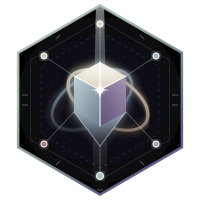

<p align="center">
  
</p>

<p align="center">
  <a href="https://github.com/nshkrdotcom/grand"></a>
  <a href="LICENSE"></a>
</p>

# Grand — first-pass G01A implementation

Grand owns **normative requirement and assurance records**. BeamCompass remains
an independent product; Grand reads only its versioned portable JSON exports.
This repository is a headless G01A prototype, **not** a verified Grand system.

**Baseline delivery:** `GRAND-G01A-20261106-A` (see `delivery/manifest.json`).
**Authoritative docset on the user's machine:**
`~/p/g/n/brainstorms/nshkrdotcom/docs/20261106/grand/grand-docset`.
Its canonical continuation entry is `control/NEXT_AGENT.md`. No docset files
are vendored into the Grand code repository.

## Repository layout

Each path has its own `mix.exs`, `.formatter.exs` and `mix.lock`. There is **no
root `mix.exs`**, no umbrella, no BeamCompass source dependency, and no BeamCompass implementation dependency. `grand_cli` is the fourth, thin orchestration app, preserving
one-way dependencies: `grand_core` <- `grand_beamcompass` and
`grand_assurance`; `grand_cli` -> all three. Development tools are locked separately in each project: Credo 1.7.19 and
Dialyxir 1.4.8 (plus ExDoc and their dependencies).

- `monorepo/grand_core`: JSON parser, deterministic codec, v1 record validation,
  and immutable append-only local file store.
- `monorepo/grand_beamcompass`: bounded, read-only v1 snapshot import/resolve.
- `monorepo/grand_assurance`: manually linked requirement revisions, explicit
  approval events, unformalized obligations, and **unrun** evidence bundles.
- `monorepo/grand_cli`: real `mix grand` import/link/approve/inspect/export.
- `fixtures`: synthetic Hold Ledger-inspired JSON inputs (no payment code).
- `scripts/check.sh`: per-project complete quality gates; fails if tools absent.
- `scripts/smoke.sh`: fixture demonstration (run only with Elixir installed).

## Usage (Elixir/Mix >= 1.15 required)

Run from `monorepo/grand_cli`. All options use long-form `--` flags:

```sh
cd monorepo/grand_cli
mix deps.get --check-locked
mix grand import ../../fixtures/beamcompass_v1.json \
  --project synthetic-ledger --store ../../grand-store
mix grand link ../../fixtures/requirement_pending.json \
  --project synthetic-ledger --snapshot synthetic-hold-snapshot-001 \
  --fact synthetic-fact-void-intent-001 --actor human:fixture-submitter \
  --store ../../grand-store
mix grand approve synthetic-REQ-void-confirmation \
  --actor human:fixture-reviewer --ack-human --store ../../grand-store
mix grand inspect requirement synthetic-REQ-void-confirmation \
  --store ../../grand-store
mix grand inspect fact synthetic-ledger synthetic-hold-snapshot-001 \
  synthetic-fact-void-intent-001 --store ../../grand-store
mix grand export synthetic-REQ-void-confirmation \
  --project synthetic-ledger --store ../../grand-store
```

To write a bundle instead of stdout, append `--out new-file.json` to `export`.
The output must not already exist. Each command emits one JSON object on stdout;
errors produce a nonzero `mix` exit status. An unchanged source snapshot can be
reimported; a conflicting object cannot overwrite the prior record. Requirement
revision 1 remains available after explicit approval creates revision 2.

### Important scope boundaries

* `--actor human:... --ack-human` is a **manual self-attestation**, not identity
  authentication. It is an authorized local prototype control; a production
  authorization design remains separate; AI-labeled actors are denied.
* Imported facts are syntactic occurrences (`source`, `proposed`, or
  `unresolved`), not observed calls or causal reachability. Capsules remain
  provisional. All object references are exact project+snapshot+fact IDs.
* A receipt contains an `UNFORMALIZED` obligation, a `verification_result`
  with `status=unrun`, and `coverage_summary.status=unassessed`. No engine or
  target software executes. The SHA-256 fingerprint is **not** a proof.
* Local storage hard-links an fsynced temporary file to an immutable path; the
  operator chooses the store root. Source paths from v1 anchors are checked as
  relative strings and are **never opened**.
* The fixture is synthetic, not a checked Hold Ledger test or a BeamCompass
  accepted P02 v2 export. No real v2 adapter is implemented.
* Do not use this as an authorization service or proof service. Do not export
  sensitive source content or grant untrusted principals write access to store.

## Quality/validation status

The receiving local agent should run, from each of the four project directories:

```sh
mix deps.get --check-locked
mix format --check-formatted
mix compile --warnings-as-errors
mix test
mix credo --strict
mix dialyzer
```

A repository-wide convenience command is `./scripts/check.sh`. The local G01B
run uses Elixir 1.20.4 / OTP 29.1.2, pinned in `.tool-versions`. Exact command
outputs and exit codes are under `delivery/g01b-logs/`; see
`delivery/G01B-VALIDATION.md` for results and limitations. G01B is complete for this local prototype. Next is G02A implementation;
see the authoritative docset `control/WORKFLOW.md` and `control/NEXT_AGENT.md`.
Versioned references and immutable JSON storage are authorized for this scope;
production authentication/durability and stable external API release remain separate.

## Documentation and licensing

- [Grand Core](monorepo/grand_core/README.md) · [Core changelog](monorepo/grand_core/CHANGELOG.md)
- [Grand BeamCompass](monorepo/grand_beamcompass/README.md) · [BeamCompass adapter changelog](monorepo/grand_beamcompass/CHANGELOG.md)
- [Grand Assurance](monorepo/grand_assurance/README.md) · [Assurance changelog](monorepo/grand_assurance/CHANGELOG.md)
- [Grand CLI](monorepo/grand_cli/README.md) · [CLI changelog](monorepo/grand_cli/CHANGELOG.md)
- [MIT License](LICENSE) — Copyright (c) 2026 nshkrdotcom

